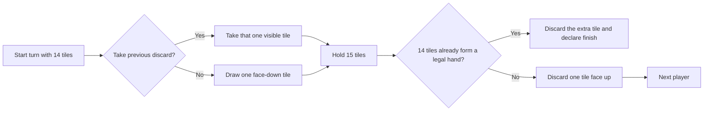

# Okey: Complete Rules, Formulas, and Worked Examples

> **Language:** English | **Players:** normally 4 | **Version:** common Turkish framework

Okey is a concealed-hand tile game. It uses Rummikub-like numbered tiles, but
it is not Rummikub: players do not normally build or rearrange shared table
melds. This guide gives the stable rules first and labels scoring choices that
must be agreed locally.

## 1. Equipment at a glance

| Component | Quantity | Calculation |
|---|---:|---|
| Numbered tiles | 104 | `4 colors x 13 numbers x 2 copies` |
| False jokers (`sahte okey`) | 2 | Special symbols; not freely wild |
| Total tiles | 106 | `104 + 2` |
| Rack after the opening discard | 14 | Starter initially has 15 |

The colors are commonly red, yellow, blue, and black. Color names do not affect
rank or value.

## 2. Find the joker correctly

One ordinary numbered tile is exposed as the **indicator** (`gösterge`). The
true joker (`okey`) is the next number in the same color.

```text
joker_number = (indicator_number mod 13) + 1
joker_color  = indicator_color
```

| Indicator | True joker | What each false joker represents |
|---|---|---|
| Blue 5 | Blue 6 | Blue 6 |
| Red 12 | Red 13 | Red 13 |
| Black 13 | Black 1 | Black 1 |

The two physical tiles matching the result are wild. A false joker is not
wild; it behaves as the ordinary tile whose identity is currently the joker.

## 3. Legal groups

| Group | Rule | Valid example | Invalid example |
|---|---|---|---|
| Run | 3 or more consecutive numbers, one color | Red `4-5-6-7` | Red 4, Blue 5, Red 6 |
| Set | 3 or 4 equal numbers, all different colors | Red/Blue/Black `9` | Red/Red/Blue `9` |
| Seven pairs | 7 pairs under the table's pair rule | two identical Blue 3 tiles form one pair | two different colors of 3 are not an identical pair |

An `1` may be low in `1-2-3` or high in `12-13-1` in the commonly documented
rule. It does not make a circular run such as `13-1-2`.

### Winning-hand formula

For an ordinary hand:

```text
sum(length of every run and set) = 14
every tile is used exactly once
every group satisfies its own rule
```

Alternatively, where seven pairs is accepted:

```text
7 legal pairs x 2 tiles = 14 tiles
```

## 4. Setup and turn flow

The indicator is selected using the table's dealing procedure. Four players
normally receive 14 tiles; the starter receives 15 and discards first.



Only the most recent discard is normally available. Melds stay concealed until
the player finishes. A player must never end an ordinary turn holding 15 tiles.

## 5. Worked winning example

Assume the indicator is Yellow 8, so both Yellow 9 tiles are wild and each
false joker represents an ordinary Yellow 9.

| Tiles | Interpretation |
|---|---|
| Red `1-2-3-4` | four-tile run |
| Blue `6-7-8` | three-tile run |
| Black/Red/Yellow `11` | three-color set |
| Black `12-13-1` | legal high-1 run |
| true joker | substitutes for the missing fourth tile in a chosen legal group |

The player must assign the joker so all 14 retained tiles partition into legal
groups, then discard the fifteenth tile. Simply holding many connected tiles is
not enough.

## 6. Finishing and scoring

The physical action used to finish, dealer rotation, indicator bonus, seven-pair
multiplier, joker discard bonus, and penalties vary. Record the table's rules as
variables instead of mixing systems:

```text
round_result = base_result
             x finish_multiplier
             x hand_multiplier
             + agreed_indicator_bonus
```

This is a bookkeeping model, not a universal tariff. Agree on each variable
before the first deal. This guide intentionally publishes no money values.

## 7. Pre-game checklist

| Question | Why it matters |
|---|---|
| Is `12-13-1` accepted? | Defines high-1 runs |
| How is seven pairs defined? | Pair identity and multiplier can differ |
| May a joker be discarded to finish? | Often changes settlement |
| What does showing the indicator do? | Bonus and timing vary |
| What happens after a false start or invalid finish? | Prevents disputes |

## Sources

- [Pagat: Okey](https://www.pagat.com/rummy/okey.html)

Rules reviewed 2026-07-11. Local, club, platform, and tournament rules take
precedence when they are stated before play.

## INEAN PLAY

INEAN PLAY provides automatic Okey tables, compatible magnetic Okey tiles,
racks, manuals, and support resources. Confirm the exact game mode and tile
compatibility for the product in use.

- [ineanplay.com](https://ineanplay.com/)
- [WhatsApp: +86 173 7839 0199](https://wa.me/8617378390199)
- [service@ineanplay.com](mailto:service@ineanplay.com)
