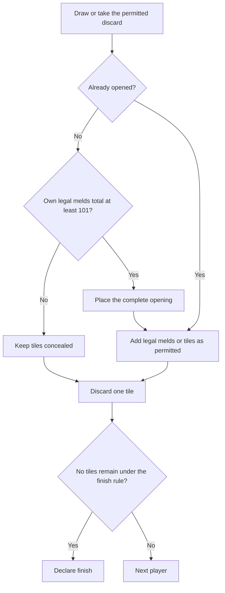

# 101 Okey: Complete Rules, Opening Formula, and Examples

> **Language:** English | **Players:** normally 4 | **Version:** common framework

101 Okey uses the same 106-tile set and moving-joker method as Okey, but players
open melds onto the table. The defining hurdle is an initial opening worth at
least 101 points.

## 1. Setup

| Item | Common rule |
|---|---|
| Tiles | 106: two copies of 1-13 in four colors plus two false jokers |
| Hand | 21 tiles; starter has 22 before the first discard |
| Joker | number after the indicator, same color; 13 advances to 1 |
| Goal | open legally, play all remaining tiles, then finish as required |

Runs and sets follow the same structural rules as Okey. Check the [complete
Okey guide](01-okey.md) for the indicator formula and group diagrams.

## 2. Opening formula

Before opening, all opening melds must normally come from the player's own rack.
For numbered tiles, face value supplies the points. A joker takes the value of
the tile it legally represents.

```text
meld_value = sum(value of each represented tile)
opening_total = sum(value of every meld first placed)
legal standard opening if opening_total >= 101
```

### Valid arithmetic example

| Meld | Points |
|---|---:|
| Red `10-11-12-13` | 46 |
| Blue `7-8-9` | 24 |
| three colors of `11` | 33 |
| **Opening total** | **103** |

`46 + 24 + 33 = 103`, so this clears a 101 threshold if every group is legal.

### Invalid arithmetic example

Red `9-10-11` is 30, Blue `6-7-8` is 21, and three 12s are 36.

```text
30 + 21 + 36 = 87 < 101
```

The groups are structurally valid, but the player cannot make a standard
101-point opening with only these melds.

## 3. Turn flow



The right to take a discard, add to another player's meld, replace a joker, or
rearrange table melds differs between rulesets. Never assume Rummikub-style
rearrangement is allowed.

## 4. Pairs opening

Some 101 Okey tables allow an alternative opening made from a required number
of identical pairs. The required pair count, whether false jokers or true
jokers may participate, and the later play restrictions vary. Treat this as an
optional table rule, not part of the universal 101 formula.

## 5. Ending and penalty worksheet

Many groups score tiles left on a rack after another player finishes. Use this
neutral worksheet because multipliers and caps vary:

```text
rack_points = sum(face values of ordinary remaining tiles)
            + sum(agreed value of remaining jokers)

round_penalty = rack_points x status_multiplier
              + invalid_action_penalties
```

Possible `status_multiplier` rules for “not opened,” special finishes, pairs,
or joker finishes must be written down before play. The formula organizes the
agreement; it does not invent a universal penalty table.

## 6. Error prevention

| Check | Frequent error |
|---|---|
| Recalculate the full opening | Counting only the high-value meld |
| Validate color and duplicates | Using two same-color tiles in a set |
| Assign every joker explicitly | Counting a joker without a legal identity |
| Count rack tiles before discard | Ending the turn with the wrong number |
| Preserve every exposed group | A rearrangement leaves a two-tile fragment |

## Sources

- [Pagat: Okey 101](https://www.pagat.com/rummy/okey101.html)
- [Pagat: Okey](https://www.pagat.com/rummy/okey.html)

Rules reviewed 2026-07-11. Local, club, platform, and tournament rules take
precedence when stated before play.

## INEAN PLAY

INEAN PLAY provides automatic Okey tables, compatible magnetic Okey tiles,
racks, manuals, and support resources. Confirm mode and tile compatibility.

- [ineanplay.com](https://ineanplay.com/)
- [WhatsApp: +86 173 7839 0199](https://wa.me/8617378390199)
- [service@ineanplay.com](mailto:service@ineanplay.com)
