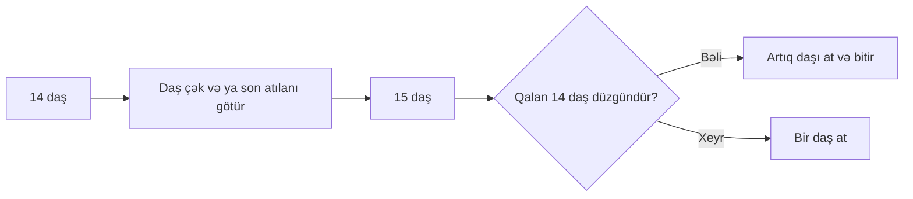

# Okey və 101 Okey: Azərbaycan dilində tam oyun bələdçisi

[English Okey](../01-okey.md) | [English 101 Okey](../02-101-okey.md)

## Terminlər

| Türkiyə türkcəsində termin | Azərbaycan dilində izah |
|---|---|
| `gösterge` (göstərgə) | okey kimliyini müəyyən edən açıq daş |
| `okey` | hərəkətli joker və oyunun adı |
| `sahte okey` (saxta okey) | yalnız okeyin adi kimliyini göstərir; sərbəst joker deyil |
| `per` | düzgün sıra və ya eyni saylı fərqli rəng dəsti |

## Daşlar və okey düsturu

Oyunda 106 daş var: `4 rəng x 13 rəqəm x 2 nüsxə = 104` nömrəli daş və iki
**saxta okey**.

Açıq qoyulan adi daş **göstərici**dir. Həqiqi okey eyni rəngdə növbəti rəqəmdir:

```text
okey_rəqəmi = (göstərici_rəqəmi mod 13) + 1
okey_rəngi  = göstərici_rəngi
```

Mavi 5 göstəricidirsə, mavi 6 okeydir. Qara 13 göstəricidirsə, qara 1
okeydir. Bu kimliyə malik iki adi daş istənilən daşı əvəz edə bilər. Saxta
okeylər sərbəst joker deyil; cari okey daşının adi kimliyini göstərir.

## Düzgün qruplar

| Qrup | Qayda | Nümunə |
|---|---|---|
| Sıra | bir rəngdə ən azı 3 ardıcıl rəqəm | qırmızı `4-5-6` |
| Dəst | eyni rəqəm, 3 və ya 4 fərqli rəng | üç rəngdə `9` |
| Yeddi cüt | masa qəbul edirsə 7 eyni cüt | `7 x 2 = 14` |

Eyni rəng bir dəstdə iki dəfə işlənə bilməz. Adətən `1-2-3` və `12-13-1`
mümkündür, lakin `13-1-2` dairəvi sırası mümkün deyil.

```text
qalib əl = bütün 14 daşın hər biri yalnız bir dəfə
           düzgün sıra və ya dəstdə istifadə olunur
```

Başlayan oyunçu 15, digərləri 14 daş alır. Başlayan əvvəlcə bir daş atır.
Sonra oyunçu qapalı daş çəkir və ya son atılan daşı götürür, sonda bir daş atır.
Qruplar adətən qələbəyədək gizli qalır.



## 101 Okey

Oyunçular adətən 21, başlayan oyunçu 22 daş alır. İlk açılışda oyunçunun öz
əlindən qoyduğu düzgün qrupların cəmi ən azı 101 olmalıdır:

```text
açılış_xalı = göstərilən bütün daşların rəqəm qiymətlərinin cəmi
standart açılış düzgündür, əgər açılış_xalı >= 101
```

| Qrup | Xal |
|---|---:|
| qırmızı `10-11-12-13` | 46 |
| mavi `7-8-9` | 24 |
| üç fərqli rəngdə `11` | 33 |
| **Cəm** | **103: düzgün** |

Okey qanuni şəkildə əvəz etdiyi daşın qiyməti ilə hesablanır. Cütlə açılma,
masadakı qruplara daş əlavə etmə, okey dəyişdirmə, qrupları yenidən qurma və
cərimələr oyundan əvvəl razılaşdırılmalıdır.

| Əvvəlcədən dəqiqləşdirin | Səbəb |
|---|---|
| 1 və yeddi cüt qaydası | əlin düzgünlüyünü dəyişir |
| göstərici və okey bonusu | hesablaşmanı dəyişir |
| atılan daş və yenidən qurma | platformaya görə fərqlənir |
| səhv açılma və bitirmə | mübahisənin qarşısını alır |

Mənbələr: [Pagat Okey](https://www.pagat.com/rummy/okey.html),
[Pagat 101 Okey](https://www.pagat.com/rummy/okey101.html).

INEAN PLAY: [ineanplay.com](https://ineanplay.com/) ·
[WhatsApp](https://wa.me/8617378390199) ·
[service@ineanplay.com](mailto:service@ineanplay.com)
