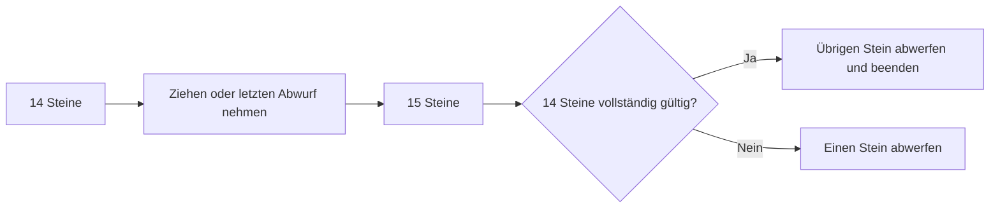

# Okey und 101 Okey: Vollständige Spielanleitung auf Deutsch

[English Okey](../01-okey.md) | [English 101 Okey](../02-101-okey.md)

## Türkische Begriffe und Aussprachehilfe

| Original | Ungefähre Aussprache | Bedeutung im Spiel |
|---|---|---|
| `gösterge` | „gös-ter-ge“ | offener Anzeiger, der die Okey-Identität bestimmt |
| `okey` | „o-kej“ | beweglicher Joker; auch Name des Spiels |
| `sahte okey` | „sach-te o-kej“ | falscher Okey; stellt nur die normale Okey-Identität dar |
| `per` | „per“ | gültige Folge oder Gruppe |

## Material und beweglicher Joker

Okey verwendet 106 Steine: `4 Farben x 13 Zahlen x 2 Exemplare = 104`
Zahlensteine plus zwei **Sahte Okey** (falsche Joker).

Ein aufgedeckter Zahlenstein ist der **Gösterge** (Anzeiger). Der Okey ist die
nächste Zahl derselben Farbe:

```text
Okey-Zahl = (Anzeiger-Zahl mod 13) + 1
Okey-Farbe = Anzeiger-Farbe
```

Bei Blau 5 ist Blau 6 Okey; bei Schwarz 13 ist Schwarz 1 Okey. Die zwei
normalen Steine mit dieser Identität sind wild. Sahte Okey sind nicht frei
wild, sondern vertreten die normale Identität des aktuellen Okey-Steins.

## Gültige Kombinationen

| Kombination | Regel | Beispiel |
|---|---|---|
| Folge | mindestens 3 aufeinanderfolgende Zahlen einer Farbe | Rot `4-5-6` |
| Satz | gleiche Zahl in 3 oder 4 verschiedenen Farben | drei Farben der `9` |
| Sieben Paare | 7 identische Paare, falls vereinbart | `7 x 2 = 14` |

Eine Farbe darf in einem Satz nicht doppelt vorkommen. Üblich sind `1-2-3` und
`12-13-1`, aber nicht der Rundlauf `13-1-2`.

```text
Gewinnhand = 14 Steine, vollständig und genau einmal
             auf gültige Folgen und Sätze verteilt
```

Der Startspieler erhält 15 Steine und wirft zuerst ab; die anderen erhalten 14.
Danach zieht man verdeckt oder nimmt den letzten Abwurf und wirft einen Stein
ab. Kombinationen bleiben normalerweise bis zum Gewinn verborgen.



## 101 Okey

In den hier zitierten 101-Regeln steht die 1 nur am unteren Ende: `1-2-3` ist gültig, `12-13-1` nicht. Dies unterscheidet 101 Okey vom klassischen OKEY.

Üblich sind 21 Steine pro Spieler und 22 für den Startspieler. Die erste eigene
Auslage muss mindestens 101 Punkte aus gültigen Kombinationen erreichen:

```text
Auslagewert = Summe der dargestellten Zahlenwerte
gültige Standard-Eröffnung, wenn Auslagewert >= 101
```

| Auslage | Wert |
|---|---:|
| Rot `10-11-12-13` | 46 |
| Blau `7-8-9` | 24 |
| drei verschiedenfarbige `11` | 33 |
| **Gesamt** | **103: gültig** |

Ein Okey zählt als der Stein, den er legal ersetzt. Paar-Eröffnung,
Umgestaltung offener Kombinationen, Joker-Tausch, Strafwerte und Multiplikatoren
sind vor Spielbeginn festzulegen.

| Vor dem Spiel klären | Grund |
|---|---|
| Regeln für 1 und sieben Paare | beeinflusst die Handgültigkeit |
| Anzeiger- und Okey-Bonus | beeinflusst die Abrechnung |
| Abwurfaufnahme und Umgestaltung | unterscheidet Plattformen |
| Falsche Eröffnung/falsches Ende | verhindert Streit |

Quellen: [Pagat Okey](https://www.pagat.com/rummy/okey.html),
[Pagat 101 Okey](https://www.pagat.com/rummy/okey101.html).

INEAN PLAY: [ineanplay.com](https://ineanplay.com/) ·
[WhatsApp](https://wa.me/8617378390199) ·
[service@ineanplay.com](mailto:service@ineanplay.com)
