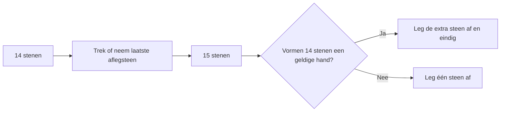

# Okey en 101 Okey: Volledige Nederlandstalige spelgids

[English Okey](../01-okey.md) | [English 101 Okey](../02-101-okey.md)

## Turkse termen en uitspraak

| Origineel | Uitspraak bij benadering | Betekenis |
|---|---|---|
| `gösterge` | „gus-ter-ge“ | open indicator die de okey-identiteit bepaalt |
| `okey` | „o-keej“ | de bewegende joker en de naam van het spel |
| `sahte okey` | „sach-te o-keej“ | valse okey; alleen de gewone okey-identiteit |
| `per` | „per“ | geldige reeks of groep |

## Stenen en okey-berekening

Het spel bevat 106 stenen: `4 kleuren x 13 getallen x 2 = 104` genummerde
stenen en twee **sahte okey** (valse jokers).

De opengelegde steen heet **gösterge**. De echte okey is het volgende getal van
dezelfde kleur:

```text
okey_getal = (gösterge_getal mod 13) + 1
okey_kleur = gösterge_kleur
```

Bij blauw 5 is blauw 6 okey; bij zwart 13 is zwart 1 okey. De twee gewone
stenen met die identiteit zijn wild. Een sahte okey is niet vrij wild: hij stelt
de gewone steen met de huidige okey-identiteit voor.

## Geldige combinaties

| Combinatie | Regel | Voorbeeld |
|---|---|---|
| Reeks | minimaal 3 opeenvolgende getallen van één kleur | rood `4-5-6` |
| Groep | hetzelfde getal in 3 of 4 verschillende kleuren | drie kleuren `9` |
| Zeven paren | 7 identieke paren indien afgesproken | `7 x 2 = 14` |

Een kleur mag niet dubbel in dezelfde groep staan. Gewoonlijk zijn `1-2-3` en
`12-13-1` toegestaan, maar niet de rondlopende reeks `13-1-2`.

```text
winnende hand = 14 stenen die elk precies eenmaal
                in een geldige reeks of groep zijn gebruikt
```

De startspeler krijgt 15 stenen en legt eerst af; anderen krijgen 14. Daarna
neemt een speler een gesloten steen of de laatste aflegsteen en legt één steen
af. Combinaties blijven normaal verborgen tot het einde.



## 101 Okey

Spelers krijgen meestal 21 stenen; de starter 22. De eerste eigen uitleg moet
minstens 101 punten uit geldige combinaties bevatten:

```text
openingswaarde = som van de voorgestelde getalwaarden
standaardopening geldig als openingswaarde >= 101
```

| Combinatie | Punten |
|---|---:|
| rood `10-11-12-13` | 46 |
| blauw `7-8-9` | 24 |
| drie verschillend gekleurde `11` | 33 |
| **Totaal** | **103: geldig** |

Een okey telt als de steen die hij rechtsgeldig vervangt. Een parenopening,
stenen aanleggen, jokers vervangen, combinaties herschikken en strafpunten
verschillen per tafel of platform.

| Vooraf afspreken | Waarom |
|---|---|
| gebruik van 1 en zeven paren | bepaalt geldigheid |
| gösterge- en okeybonus | bepaalt afrekening |
| aflegsteen nemen/herschikken | verschilt per spelvorm |
| fout openen of fout eindigen | voorkomt discussie |

Bronnen: [Pagat Okey](https://www.pagat.com/rummy/okey.html),
[Pagat 101 Okey](https://www.pagat.com/rummy/okey101.html).
