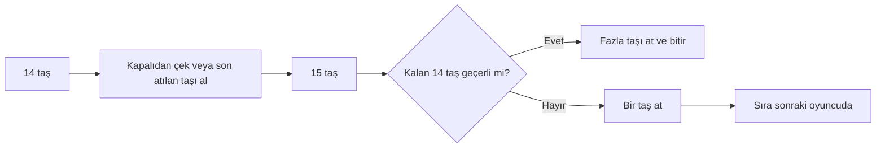

# Okey ve 101 Okey: Tam Türkçe Oyun Kılavuzu

[English rules](../01-okey.md) | [English 101 Okey](../02-101-okey.md)

## Terimler

| Terim | Açıklama |
|---|---|
| `gösterge` | Okey kimliğini belirleyen açık taş |
| `okey` | Göstergenin aynı renkte bir sonraki sayısı; iki normal kopyası joker olur |
| `sahte okey` | Okeyin normal kimliğini temsil eden özel taş; serbest joker değildir |
| `per` | Geçerli seri veya aynı sayılı farklı renk grubu |

## Okey taşları ve gösterge hesabı

| Parça | Adet | Hesap |
|---|---:|---|
| 1-13 numaralı taşlar | 104 | `4 renk x 13 sayı x 2 takım` |
| Sahte okey | 2 | Serbest joker değildir |
| Toplam | 106 | `104 + 2` |

Açılan normal taş **gösterge**dir. Aynı renkte göstergenin bir sonraki sayısı
**okey** olur.

```text
okey_sayısı = (gösterge_sayısı mod 13) + 1
okey_rengi  = gösterge_rengi
```

Örnek: mavi 5 göstergeyse mavi 6 okeydir. Siyah 13 göstergeyse siyah 1
okeydir. Okey olan iki normal taş istenen taşı temsil edebilir. İki sahte okey
ise o turdaki okey taşının normal kimliğini temsil eder; serbest joker değildir.

## Okey'de geçerli perler

| Per | Kural | Örnek |
|---|---|---|
| Seri | Aynı renkte en az 3 ardışık sayı | kırmızı `4-5-6-7` |
| Grup | Aynı sayı, 3 veya 4 farklı renk | üç farklı renkte `9` |
| Çifte bitiş | Masa kabul ediyorsa 7 özdeş çift | `7 x 2 = 14 taş` |

Aynı renkten iki eş sayı bir grubun içinde kullanılamaz. Yaygın kurala göre 1,
`1-2-3` veya `12-13-1` içinde kullanılabilir; `13-1-2` şeklinde dönülmez.

```text
normal bitiş: bütün perlerdeki taş sayısı = 14
ve her taş tam bir geçerli perde kullanılır
```

## Okey turu



Başlayan oyuncu 15, diğerleri 14 taş alır; başlayan oyuncu çekmeden bir taş
atar. Perler normalde bitişe kadar elde gizli tutulur.

## 101 Okey açılış hesabı

Bu bölümdeki 101 kuralında 1 yalnız düşük uçta kullanılır: `1-2-3` geçerlidir, `12-13-1` geçerli değildir. Klasik OKEY ile bu farkı koruyun.

Oyuncular genellikle 21, başlayan oyuncu 22 taş alır. İlk açılışta oyuncunun
kendi elinden koyduğu geçerli perlerin toplamı en az 101 olmalıdır.

```text
per_değeri = temsil edilen taşların sayı değerleri toplamı
açılış_toplamı = ilk açılan bütün perlerin toplamı
standart açılış geçerli ise açılış_toplamı >= 101
```

| Per | Puan |
|---|---:|
| kırmızı `10-11-12-13` | 46 |
| mavi `7-8-9` | 24 |
| üç farklı renkte `11` | 33 |
| **Toplam** | **103: geçerli** |

Okey hangi taşı temsil ediyorsa o taşın sayısal değeriyle sayılır. Çift açma,
yerden taş alma, okey değiştirme, masadaki perleri düzenleme, açmamış oyuncu
cezası ve özel bitiş çarpanları masa veya platform kuralıdır.

## Oyun öncesi yazılı kontrol

| Konu | Kararlaştırılacak kural |
|---|---|
| Okey | Gösterge bonusu ve okeyle bitiş |
| Çift | Kaç çiftle açılır/biter, çarpanı nedir |
| 101 | Açılışta yalnız kendi taşları mı sayılır |
| Masa | Per ekleme ve yeniden düzenleme sınırı |
| Ceza | Açmamış el, yanlış açma ve yanlış bitiş |

Kaynaklar: [Pagat Okey](https://www.pagat.com/rummy/okey.html),
[Pagat 101 Okey](https://www.pagat.com/rummy/okey101.html). Yerel ve turnuva
kuralları önceden bildirildiğinde önceliklidir.
